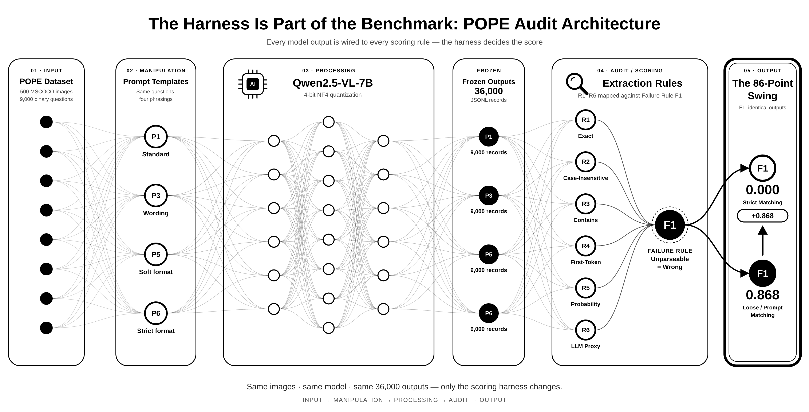

# **The Harness Is Part of the Benchmark**

## A Controlled Audit of Prompt and Extraction Sensitivity in POPE

[](https://www.python.org/)
[](https://pytorch.org/)
[](https://github.com/ridoy-adhikary/Pope_scoring_sensitivity)

> ## TL;DR
>
> With model outputs held completely frozen, the reported POPE F1 score swings by **86.8 points — from 0.000 to 0.868 — solely because of the prompt template and answer-extraction rule**. The evaluation harness is not a neutral measurement layer: it can determine the apparent capability being reported.

## Overview

This repository contains a controlled audit of the POPE object-hallucination benchmark using **Qwen2.5-VL-7B** with 4-bit NF4 quantization. We generated **36,000 frozen JSONL outputs** and replayed multiple prompt and extraction configurations against the same predictions. The results show that a model's reported capability can be an artifact of the evaluation harness rather than a stable property of the model.

## Audit Architecture



The pipeline separates model inference from evaluation so that harness effects can be measured without changing the underlying outputs:

1. **Input** — Load the POPE questions, images, labels, and preregistered evaluation configuration.
2. **Manipulation** — Vary prompt templates and answer-extraction rules while preserving the model output corpus.
3. **Processing** — Run Qwen2.5-VL-7B in 4-bit NF4 quantization and freeze the resulting JSONL responses.
4. **Audit** — Re-score the identical responses under each extraction rule and compare precision, recall, and F1.
5. **Output** — Produce the aggregate CSV, sensitivity figures, tables, and the accompanying research report.

## Key Results

F1 scores across prompt templates and extraction rules. `R1`, `R3`, and `R5` are the three extraction rules evaluated in the audit.

| Prompt | Template | R1 F1 | R3 F1 | R5 F1 |
|:------:|:---------|------:|------:|------:|
| **P1** | Standard | 0.000 | 0.836 | 0.836 |
| **P3** | Wording | 0.000 | 0.835 | 0.835 |
| **P5** | Soft Format | 0.000 | 0.856 | 0.868 |
| **P6** | Strict Format | 0.861 | 0.861 | 0.861 |

The same frozen model outputs therefore support a range of apparently contradictory conclusions. In particular, the difference between **P1/R1 = 0.000** and **P5/R5 = 0.868** is an evaluation-harness effect, not a change in model weights or inference outputs.

## Reproducibility

The complete 8-page report is available at [`07_report/Pope_Audit.pdf`](07_report/Pope_Audit.pdf). To regenerate the analysis figures and summary table from the aggregated scoring CSV:

```bash
bash run_all.sh
```

The raw 36,000 JSONL output files are intentionally excluded from version control to keep the repository lightweight. The tracked aggregate at [`04_scoring/results_summary.csv`](04_scoring/results_summary.csv), analysis scripts, figures, and report provide the compact audit record.

## Repository Structure

```text
.
├── 00_preregistration/
│   └── AMENDMENTS.md
├── 01_data/
│   └── download_pope.py
├── 03_inference/
│   ├── run_sweep.py
│   └── run_all_sweeps.sh
├── 04_scoring/
│   ├── results_summary.csv
│   └── score_outputs.py
├── 06_analysis/
│   ├── architecture.png
│   ├── make_figures.py
│   └── table1_results.md
└── 07_report/
    ├── Pope_Audit.pdf
    └── report.md
```

## Limitations

- This audit evaluates **only Qwen2.5-VL-7B**. Additional model comparisons were not possible because shared-server network restrictions blocked access to AWS and PyPI.
- The study isolates prompt and extraction sensitivity for one model and one benchmark; it does not claim that the measured swing generalizes identically to every vision-language model or evaluation suite.
- The conclusions depend on the preregistered prompt and extraction configurations documented in [`00_preregistration/AMENDMENTS.md`](00_preregistration/AMENDMENTS.md).

## Citation

If you use this audit or its results, please cite:

```bibtex
@misc{adhikary2026popeharness,
  author       = {Ridoy Kumar Adhikary},
  title        = {The Harness Is Part of the Benchmark: A Controlled Audit of Prompt and Extraction Sensitivity in POPE},
  institution  = {Sichuan University},
  year         = {2026},
  howpublished = {\url{https://github.com/ridoy-adhikary/Pope_scoring_sensitivity}}
}
```

---

Maintained by [Ridoy Kumar Adhikary](https://github.com/ridoy-adhikary).
